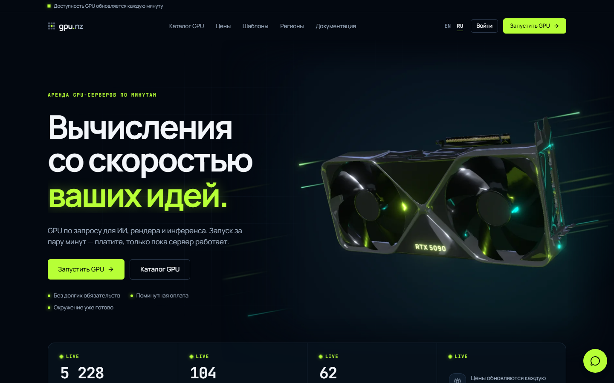
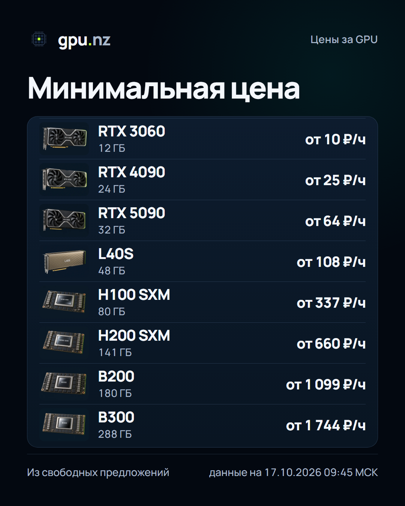
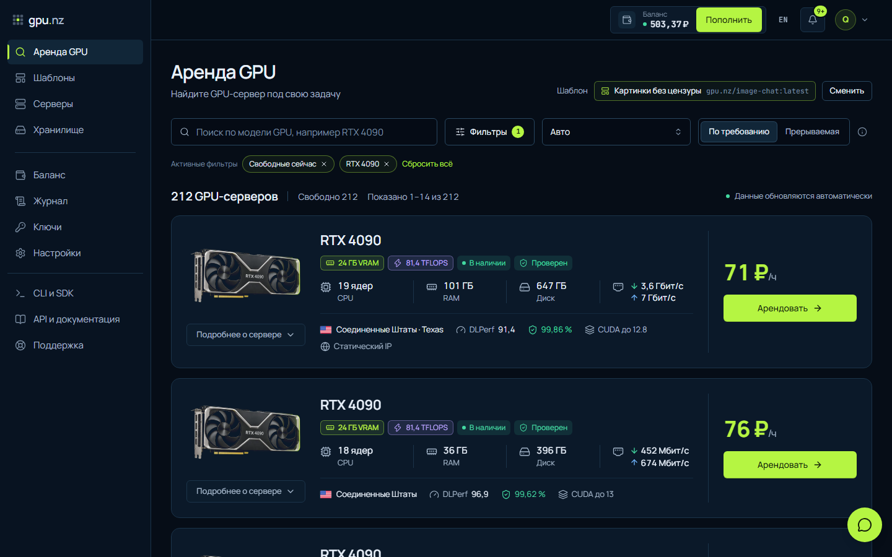
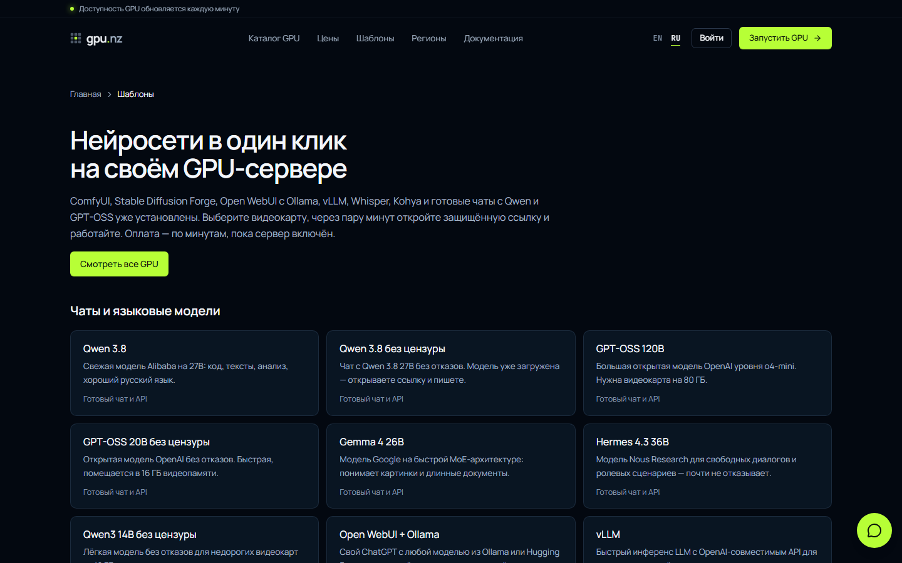
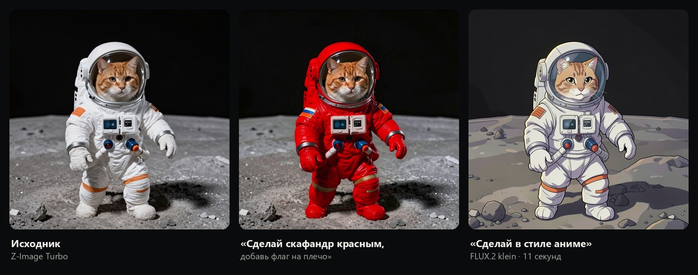
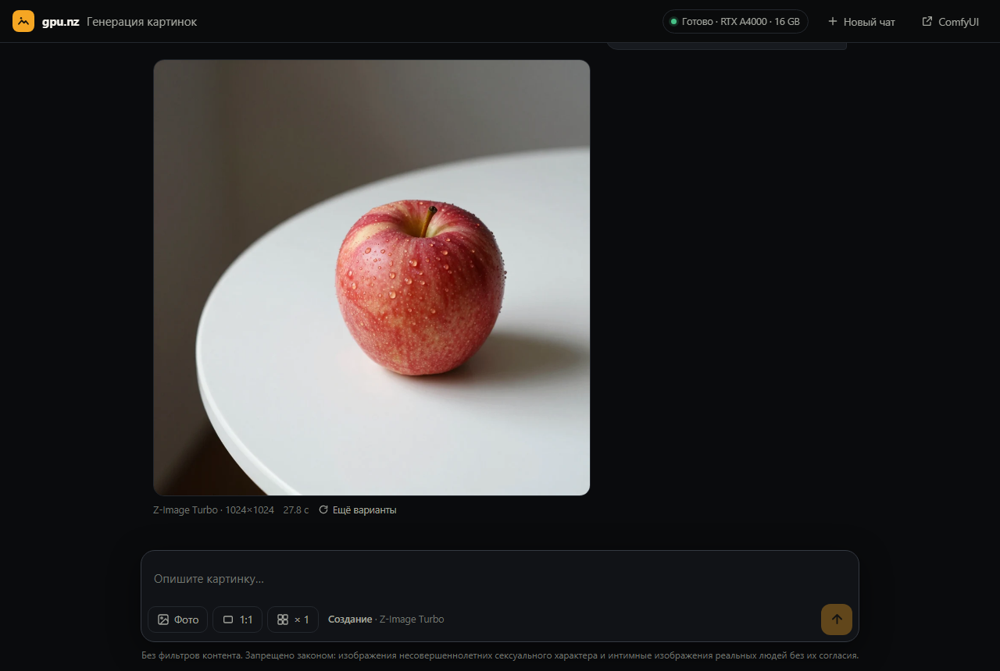
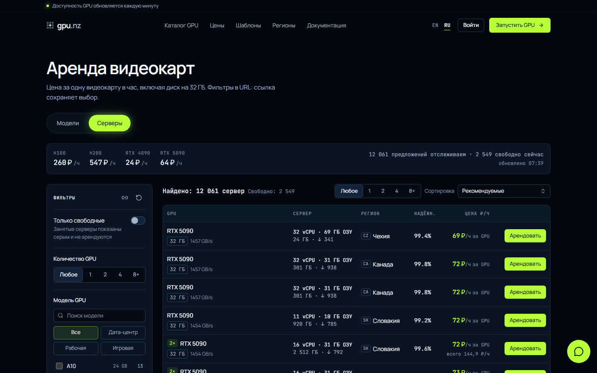
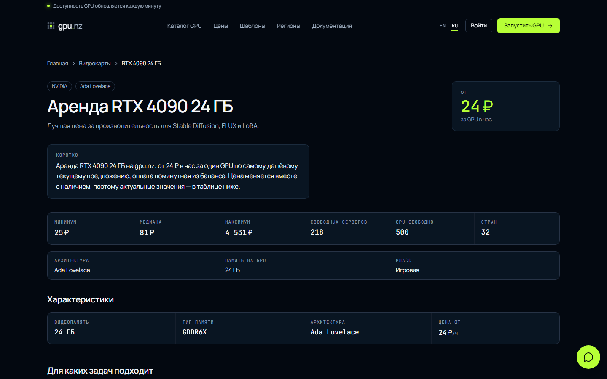

<div align="center">

# Аренда GPU-серверов по минутам — RTX 4090, RTX 5090, A100, H100

**[gpu.nz](https://gpu.nz/?utm_source=github&utm_medium=readme&utm_campaign=arenda-gpu)** — облачные видеокарты для нейросетей, рендера и обучения моделей. Тысячи GPU в 60+ странах, оплата в рублях и криптовалюте, сервер готов через пару минут.

[](https://gpu.nz/gpu?utm_source=github&utm_medium=readme&utm_campaign=arenda-gpu)
[](https://gpu.nz/gpu/rtx-4090-24gb?utm_source=github&utm_medium=readme&utm_campaign=arenda-gpu)
[](https://gpu.nz/pricing?utm_source=github&utm_medium=readme&utm_campaign=arenda-gpu)

[English version](README.en.md)



</div>

## Что такое gpu.nz

gpu.nz — сервис аренды серверов с видеокартами NVIDIA. Вы выбираете GPU в каталоге, нажимаете «Арендовать» — и через несколько минут получаете сервер с SSH, JupyterLab и готовым окружением: ComfyUI, Stable Diffusion, Ollama, vLLM, PyTorch или чат с языковой моделью. Оплата идёт **по минутам** из баланса, без минимального срока и абонентской платы: остановили сервер — счётчик GPU остановился.

- **Почасовая и поминутная аренда GPU** — платите только за время работы, цена фиксируется в момент запуска.
- **Больше сотни моделей видеокарт** — от RTX 3060 до H100, H200, B200 и RTX PRO 6000 96 ГБ.
- **Оплата из России** — СБП и криптовалюта (USDT, TON, BTC и другие). Пополнение от 100 ₽.
- **Готовые шаблоны** — нейросеть запускается в один клик, без установки драйверов и CUDA.
- **API, CLI и Telegram-бот** — арендуйте GPU из скрипта, терминала или прямо из Telegram.

## Цены на аренду видеокарт



Минимальная цена за одну видеокарту в час на 17 октября 2026 года, по свободным серверам каталога:

| Видеокарта | Память | Цена от |
|---|---|---|
| RTX 3060 | 12 ГБ | 10 ₽/ч |
| RTX A4000 | 16 ГБ | 14 ₽/ч |
| RTX 3090 | 24 ГБ | 22 ₽/ч |
| RTX 4090 | 24 ГБ | 25 ₽/ч |
| RTX 5090 | 32 ГБ | 64 ₽/ч |
| L40S | 48 ГБ | 108 ₽/ч |
| A100 80 ГБ | 80 ГБ | 181 ₽/ч |
| H100 SXM | 80 ГБ | 337 ₽/ч |
| H200 | 141 ГБ | 660 ₽/ч |
| B200 | 180 ГБ | 1 099 ₽/ч |

Цены живые и меняются вместе с рынком: актуальные — в [каталоге GPU](https://gpu.nz/gpu?utm_source=github&utm_medium=readme&utm_campaign=arenda-gpu) и на странице [цен](https://gpu.nz/pricing?utm_source=github&utm_medium=readme&utm_campaign=arenda-gpu). **Прерываемые серверы** стоят до 50% дешевле — подходят для длинных задач, которые переживут паузу.

<br clear="right">

## Как арендовать GPU за 2 минуты

1. **Зарегистрируйтесь** на [gpu.nz](https://gpu.nz/?utm_source=github&utm_medium=readme&utm_campaign=arenda-gpu) — почта, Google или Telegram.
2. **Пополните баланс** от 100 ₽ — через СБП или криптовалютой.
3. **Выберите видеокарту и шаблон** в каталоге и нажмите «Арендовать». Сервер запустится за несколько минут, ссылки на приложения и SSH появятся на странице сервера.



## Готовые нейросети в один клик

| Шаблон | Что делает |
|---|---|
| **Картинки без цензуры** | Чат для генерации изображений: описание → картинка, правка своего фото словами. Z-Image и FLUX.2 |
| **ComfyUI** | Генерация картинок и видео на нодах: FLUX, SDXL, Wan, HunyuanVideo |
| **Stable Diffusion WebUI Forge** | Привычный интерфейс AUTOMATIC1111 с ControlNet и LoRA |
| **InvokeAI, SwarmUI** | Студии для художников: холст, слои, инпейнт |
| **Чаты с LLM** | Qwen 3.8, GPT-OSS 120B, Gemma 4, Hermes и версии без цензуры — модель уже загружена |
| **Ollama + Open WebUI** | Свой ChatGPT с любой моделью из Ollama и Hugging Face |
| **vLLM** | Быстрый инференс с OpenAI-совместимым API |
| **Wan2GP** | Генерация видео Wan 2.2, Hunyuan, LTX |
| **ACE-Step, Whisper** | Музыка с вокалом и расшифровка речи на 99 языках |
| **Kohya, AI Toolkit, FluxGym, Unsloth** | Обучение LoRA и дообучение LLM |
| **PyTorch + Jupyter, Ubuntu, свой Docker** | Чистая среда для своих задач |



## Генерация картинок без цензуры в чате

Новый шаблон «Картинки без цензуры» — чат, в котором нейросеть рисует по описанию или переделывает загруженное фото. Модели работают на вашем арендованном GPU, поэтому фильтров контента нет и никто не видит ваши картинки. Внутри **Z-Image Turbo** (картинки по тексту, понимает русский) и **FLUX.2 klein 4B** (правка фото и объединение картинок), обе под лицензией Apache 2.0. На RTX A4000 картинка 1024×1024 рисуется за ~30 секунд, правка — за ~11 секунд.





Подробнее: [нейросеть для генерации изображений без ограничений](https://gpu.nz/templates/image-chat?utm_source=github&utm_medium=readme&utm_campaign=arenda-gpu).

## Каталог: RTX 4090, H100, A100 и ещё сотня моделей

У каждой видеокарты есть своя страница с ценами, характеристиками и подходящими задачами: [RTX 4090](https://gpu.nz/gpu/rtx-4090-24gb?utm_source=github&utm_medium=readme&utm_campaign=arenda-gpu), [RTX 5090](https://gpu.nz/gpu/rtx-5090-32gb?utm_source=github&utm_medium=readme&utm_campaign=arenda-gpu), [RTX 3090](https://gpu.nz/gpu/rtx-3090-24gb?utm_source=github&utm_medium=readme&utm_campaign=arenda-gpu), [A100](https://gpu.nz/gpu/a100-sxm4-80gb?utm_source=github&utm_medium=readme&utm_campaign=arenda-gpu), [H100](https://gpu.nz/gpu/h100-sxm-80gb?utm_source=github&utm_medium=readme&utm_campaign=arenda-gpu), [H200](https://gpu.nz/gpu/h200-141gb?utm_source=github&utm_medium=readme&utm_campaign=arenda-gpu), [L40S](https://gpu.nz/gpu/l40s-48gb?utm_source=github&utm_medium=readme&utm_campaign=arenda-gpu).





## API и CLI

Каталог доступен без ключа, остальное — по API-ключу из личного кабинета ([документация](https://gpu.nz/docs?utm_source=github&utm_medium=readme&utm_campaign=arenda-gpu)).

```bash
# все модели GPU с минимальной ценой
curl https://gpu.nz/api/v1/gpus

# CLI для Linux, macOS и WSL
curl -fsSL https://gpu.nz/install.sh | sh
gpunz login
gpunz search --gpu rtx-4090 --max-price 40 --verified
gpunz create <OFFER_ID> --template comfyui --disk 80
```

## Кому подходит

- **ML-инженерам и исследователям** — обучение и дообучение моделей на A100, H100 и H200 без покупки железа.
- **Художникам и дизайнерам** — Stable Diffusion, FLUX и ComfyUI на RTX 4090 без очередей и лимитов.
- **Разработчикам** — свой OpenAI-совместимый API на vLLM или Ollama, CI с GPU, рендер.
- **Студентам** — недорогие RTX 3060 и 3090 для курсов и экспериментов, оплата по минутам.

## Частые вопросы

**Сколько стоит аренда GPU-сервера?**
От 10 ₽ в час за RTX 3060 и от 25 ₽ за RTX 4090; H100 — от 337 ₽ в час. Оплата поминутная, цена фиксируется при запуске. Трафик оплачивается отдельно, его цена видна до запуска.

**Как оплатить из России?**
Через СБП или криптовалютой (USDT, TON, BTC и другие). Минимальное пополнение — 100 ₽.

**Есть ли минимальный срок аренды?**
Нет. Сервер можно запустить на 10 минут и удалить — вы заплатите только за эти минуты.

**Что такое прерываемый сервер?**
Тот же сервер до 50% дешевле, но его могут приостановить, если владелец железа получит заказ по полной цене. Подходит для задач с контрольными точками.

**Можно ли запустить свой Docker-образ?**
Да, шаблон «Свой Docker-образ» запускает любой образ из Docker Hub или своего реестра с SSH и нужными портами.

## Ссылки

- Сайт: [gpu.nz](https://gpu.nz/?utm_source=github&utm_medium=readme&utm_campaign=arenda-gpu)
- Каталог GPU: [gpu.nz/gpu](https://gpu.nz/gpu?utm_source=github&utm_medium=readme&utm_campaign=arenda-gpu)
- Шаблоны: [gpu.nz/templates](https://gpu.nz/templates?utm_source=github&utm_medium=readme&utm_campaign=arenda-gpu)
- Гайды: [gpu.nz/guides](https://gpu.nz/guides?utm_source=github&utm_medium=readme&utm_campaign=arenda-gpu)
- Telegram-бот: [@gpunzbot](https://t.me/gpunzbot) · канал: [@gpunz](https://t.me/gpunz)

---

<sub>Аренда GPU, аренда видеокарты, аренда сервера с GPU, GPU сервер в аренду, облачный GPU, аренда RTX 4090, аренда H100, аренда A100, сервер для нейросети, почасовая аренда GPU, облачные вычисления на видеокартах.</sub>
